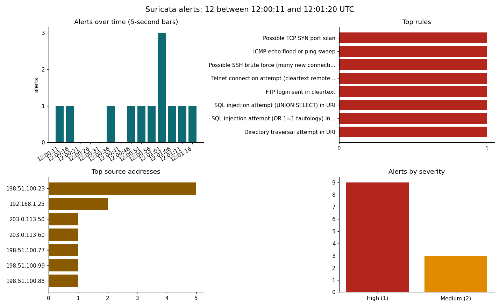

# CodeAlpha_NetworkIntrusionDetectionSystem

A network intrusion detection system (NIDS) built on [Suricata](https://suricata.io), for **Task 4 (Network Intrusion Detection System)** of the CodeAlpha Cyber Security Internship.

It has 12 custom detection rules, continuous live monitoring, an automatic response script, and a dashboard that visualises the alerts.

> **Use it responsibly.** Monitor and test only networks you own or have permission to use. The response script can change firewall rules, so it runs in dry-run mode unless you ask otherwise.

## How the pieces fit

```
network traffic --> Suricata + rules/local.rules --> logs/eve.json, logs/fast.log
                                                          |
                               +--------------------------+------------------------+
                               |                                                   |
                    scripts/responder.py                               scripts/visualize.py
        block external offenders, flag internal hosts                  dashboard picture of alerts
```

| File | Purpose |
|---|---|
| `rules/local.rules` | The 12 detection rules |
| `scripts/run_ids.sh` | Starts Suricata live on a network interface with these rules |
| `scripts/responder.py` | Reads alerts and blocks or flags the source |
| `scripts/visualize.py` | Draws the alert dashboard (`docs/alerts_dashboard.png`) |
| `scripts/generate_test_traffic.py` | Writes `pcaps/attack_demo.pcap`: one example of every attack, plus ordinary traffic |
| `scripts/test_rules.py` | Self-test: replays the capture through Suricata and checks every rule |

## Requirements

- Linux (Debian, Ubuntu or Kali). On Windows use WSL2 or a Linux VM.
- Suricata 6 or 7: `sudo apt install suricata` (tested with 7.0.3 on Ubuntu 24.04)
- Python 3.8 or newer. `pip install -r requirements.txt` adds Scapy (test traffic) and matplotlib (dashboard).

## Quick start: test the rules without touching a network

```bash
python3 scripts/generate_test_traffic.py     # writes pcaps/attack_demo.pcap (nothing is sent anywhere)
python3 scripts/test_rules.py                # replays it through Suricata and checks every rule
```

Output of a real run:

```
SID      Source           Alerts  Rule
1000001  203.0.113.50     1       LOCAL Possible TCP SYN port scan  [PASS]
1000002  203.0.113.60     1       LOCAL ICMP echo flood or ping sweep  [PASS]
1000003  198.51.100.77    1       LOCAL Possible SSH brute force (many new connections)  [PASS]
1000004  198.51.100.99    1       LOCAL Telnet connection attempt (cleartext remote access)  [PASS]
1000005  198.51.100.88    1       LOCAL FTP login sent in cleartext  [PASS]
1000006  198.51.100.23    1       LOCAL SQL injection attempt (UNION SELECT) in URI  [PASS]
1000007  198.51.100.23    1       LOCAL SQL injection attempt (OR 1=1 tautology) in URI  [PASS]
1000008  198.51.100.23    1       LOCAL Directory traversal attempt in URI  [PASS]
1000009  198.51.100.23    1       LOCAL Cross-site scripting attempt (<script>) in URI  [PASS]
1000010  198.51.100.23    1       LOCAL Known scanner or attack tool User-Agent  [PASS]
1000011  192.168.1.25     1       LOCAL DNS query with a very long label (possible tunnelling)  [PASS]
1000012  192.168.1.25     1       LOCAL Outbound connection to TCP 4444 (common reverse-shell port)  [PASS]

Alerts from ordinary traffic: 0 (expected 0)   Unexpected rules fired: 0 (expected 0)
Total alerts: 12 (expected 12)
RESULT: all checks passed
```

The capture also contains ordinary web, DNS, SSH and ping traffic, so the test proves the rules stay quiet when nothing is wrong. The alerts are written to `logs/fast.log` (one line each) and `logs/eve.json` (full detail, one JSON object per line).

## Live monitoring

```bash
ip -br addr                                          # find your interface name
sudo ./scripts/run_ids.sh eth0 192.168.1.10/32       # interface, then the network or host you protect
tail -f logs/fast.log                                # alerts appear here as they happen
```

The second argument becomes `HOME_NET`. The rules look for attackers coming from outside it (`$EXTERNAL_NET`) to inside it, so **set it to the machine you are protecting**. In a one-subnet lab, where the attacking VM sits in the same private range, giving only the victim's address makes the attacker count as external.

To add the Emerging Threats Open rules as well, run `sudo suricata-update` and start with `WITH_ET=1 sudo ./scripts/run_ids.sh ...`. This needs internet access and was not tested here.

To try each rule against your own lab machine, run these from another machine (replace `<target>` with the protected host):

| SID | Detects | Command |
|---|---|---|
| 1000001 | SYN port scan | `nmap -sS -p 1-1000 <target>` |
| 1000002 | Ping flood or sweep | `ping -c 20 -i 0.2 <target>` |
| 1000003 | SSH brute force | `for i in $(seq 8); do nc -z -w1 <target> 22; done` |
| 1000004 | Telnet attempt | `nc -z -w1 <target> 23` |
| 1000005 | FTP login in cleartext | `printf 'USER anonymous\r\n' \| nc <target> 21` |
| 1000006 | SQL injection (UNION) | `curl "http://<target>/?id=1%20UNION%20SELECT%201,2"` |
| 1000007 | SQL injection (OR 1=1) | `curl "http://<target>/?u=admin%27%20OR%20%271%27%3D%271"` |
| 1000008 | Directory traversal | `curl "http://<target>/?file=../../etc/passwd"` |
| 1000009 | Cross-site scripting | `curl "http://<target>/?q=%3Cscript%3Ealert(1)%3C/script%3E"` |
| 1000010 | Scanner User-Agent | `curl -A "sqlmap/1.7" http://<target>/` |
| 1000011 | DNS tunnelling heuristic | from a protected host: `dig $(printf 'a%.0s' $(seq 60)).example.com` |
| 1000012 | Outbound port 4444 | from a protected host: `nc -z -w1 <any external host> 4444` |

The web rules need a web server listening on the target.

## Response mechanism

`scripts/responder.py` reads `eve.json` and reacts when a source raises alerts (by default one alert of severity 1 or 2 within 5 minutes):

- **External source:** blocked with an `iptables` rule (`ip6tables` for IPv6). Blocks expire after an hour and are removed when the responder exits.
- **Internal source (inside `--home-net`):** flagged in the log but **not blocked**. Blocking inbound traffic would not stop a compromised host's outbound connections, and could lock out an administrator. The host needs investigating or isolating.
- **Never touched:** loopback and anything listed in `--allow`.

It is a dry run unless you pass `--enforce`. Replaying the demo log:

```
$ python3 scripts/responder.py logs/eve.json
responder started (dry run), reading logs/eve.json
BLOCK 203.0.113.50: 1 alert(s) in 300s: LOCAL Possible TCP SYN port scan
      dry run, would run: iptables -I INPUT -s 203.0.113.50 -m comment --comment nids-responder -j DROP
BLOCK 203.0.113.60: 1 alert(s) in 300s: LOCAL ICMP echo flood or ping sweep
      dry run, would run: iptables -I INPUT -s 203.0.113.60 -m comment --comment nids-responder -j DROP
...
FLAG  192.168.1.25 (internal): 1 alert(s): LOCAL DNS query with a very long label (possible tunnelling). Not blocked; investigate or isolate this host.
finished: 12 alerts seen, 6 sources blocked, 1 internal hosts flagged
```

Live use, watching new alerts as they arrive (list your gateway and your own machine in `--allow`):

```bash
sudo python3 scripts/responder.py --follow --enforce --allow 192.168.1.1,192.168.1.5
```

Every action is also written to `logs/response.log`. If the responder is ever killed with `kill -9`, remove leftover rules with `sudo iptables -S INPUT | grep nids-responder`.

For automatic blocking at the packet level (an inline IPS) Suricata can also run with `drop` rules instead of `alert` rules. That needs a different setup (NFQUEUE) and is not covered here.

## Dashboard

```bash
python3 scripts/visualize.py logs/eve.json -o docs/alerts_dashboard.png
```



It shows alerts over time, the top rules, the top source addresses and the severity split. The picture above was built from the demo capture.

## How a rule works

```
alert tcp $EXTERNAL_NET any -> $HOME_NET 22 (msg:"..."; flow:to_server; flags:S; threshold:type both, track by_src, count 5, seconds 60; classtype:attempted-admin; sid:1000003;)
```

The part before the brackets is the header: the action (`alert`), the protocol, the source address and port, an arrow, and the destination address and port. The part in brackets holds the conditions and settings: `flags:S` matches the first packet of a connection (a SYN), `flow:to_server` means client to server, `threshold` fires once when one source reaches 5 hits in 60 seconds, `classtype` sets the priority, and `sid` is the rule's unique number.

## Verification

All of the following were run with Suricata 7.0.3:

- Rule syntax loads cleanly (`suricata -T`).
- `scripts/test_rules.py`: 12 of 12 rules fire exactly once on the demo capture, with no alerts from ordinary traffic.
- Live capture: Suricata on the loopback interface raised the SQL injection and scanner User-Agent alerts for a real HTTP request. `run_ids.sh` started and stopped cleanly on a real interface.
- Responder: dry-run replay, follow mode with a file that grows while it watches, and `--enforce` (an `iptables` rule appeared and was removed on exit).

## Limitations and notes

- The rules are simple heuristics. Thresholds and patterns will need tuning on a real network, and they will miss attacks that are encrypted (HTTPS hides the URL and headers from the web rules) or deliberately obfuscated. A maintained rule set such as Emerging Threats Open covers far more.
- The demo capture is synthetic, written by `generate_test_traffic.py`.
- Automatic blocking has a risk. An attacker who spoofs a victim's address can trick the responder into blocking it. Keep your `--allow` list current, start with a dry run, and keep block times short.
- **Loopback quirk:** to run Suricata on `lo`, lower its MTU first (`sudo ip link set lo mtu 1500`), because the default 65536 does not fit the capture ring. Restore it afterwards (`sudo ip link set lo mtu 65536`). Real interfaces are not affected.

## Task 4 requirements and where they are covered

| Requirement | Where |
|---|---|
| Set up a network-based IDS using Snort or Suricata | Suricata, started by `scripts/run_ids.sh` |
| Configure rules and alerts for suspicious or malicious activity | `rules/local.rules`, alerts in `logs/fast.log` and `logs/eve.json` |
| Monitor network traffic continuously | Live mode of `run_ids.sh` |
| Implement response mechanisms for detected intrusions | `scripts/responder.py` |
| Optionally visualise detected attacks | `scripts/visualize.py` |
